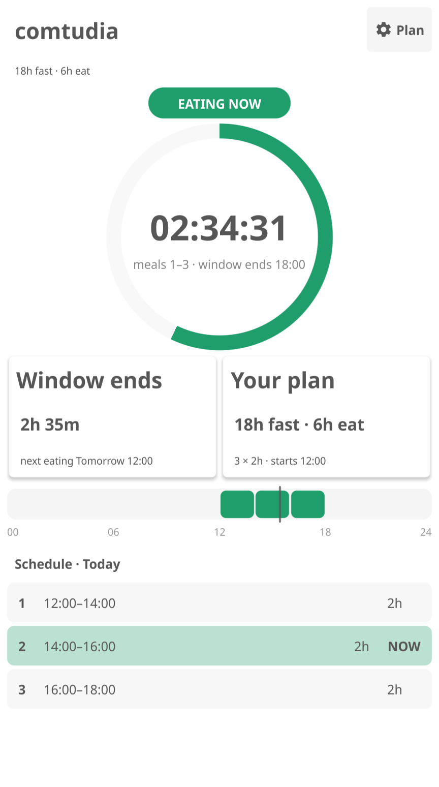
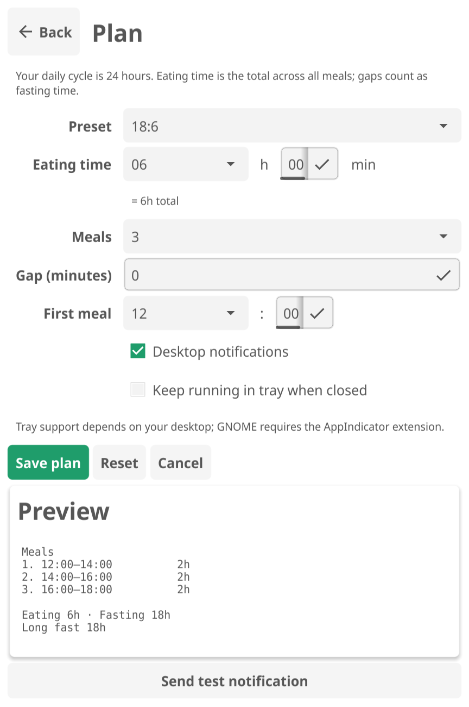

# comtudia

A small Linux desktop app for tracking a recurring eating window. The name
comes from the Spanish phrase **“comienza tu día”** — start your day.

Set your fasting/eating split, split the eating window into meals, and see how
long until the next time you eat. Built with Go and
[Fyne](https://fyne.io/).



## App identity

| Item | Value |
| --- | --- |
| Display name | `comtudia` |
| Fyne app ID | `com.comtudia.app` |
| Go module | `com.comtudia.app` |
| Binary | `bin/comtudia` |
| Config | `$XDG_CONFIG_HOME/comtudia/plan.json` |

## Features

- Live countdown to the next eating time
- 24-hour timeline with meal blocks and a current-time marker
- Daily schedule list with the current/next meal highlighted
- Configurable fasting/eating split, meal count, meal gaps, and start time
- Grouped eating-time input with a live total readout
- Presets for 16:8, 18:6, and 20:4
- Progress ring for the current fasting or eating phase
- Optional desktop notifications on eating/fasting transitions
- Optional system tray status and menu
- Settings persisted locally, with atomic writes



## How the schedule works

The cycle is always 24 hours. Meals are equally sized and the optional gap
between meals counts as fasting time.

For example, 18h fasting / 6h eating, 3 meals, starting at 12:00:

| Setting | Value |
| --- | --- |
| Eating total | 6h |
| Meals | 3 × 2h |
| Gap | 0 |
| Meal times | 12:00–14:00, 14:00–16:00, 16:00–18:00 |
| Fasting | 18:00–12:00 |

With a 1h gap between meals:

- Meals: 12:00–14:00, 15:00–17:00, 18:00–20:00
- Total eating is still 6h
- Total fasting is still 18h: 16h outside the meal spread + two 1h meal gaps

On the settings screen, eating time is entered as hours + minutes and the
resulting total is shown underneath the fields.

Meal times are anchored to the local wall clock, and meal durations are
preserved across DST transitions. On the day the clock changes, a later meal
can shift slightly relative to the wall clock.

## Requirements

- Go 1.24+
- GCC and the Fyne graphics headers

On Debian/Ubuntu:

```bash
sudo apt update
sudo apt install -y golang-go gcc pkg-config libgl1-mesa-dev xorg-dev \
  libwayland-dev libxkbcommon-dev
```

## Run

```bash
make run
```

Build a binary:

```bash
make build
./bin/comtudia
```

Run the checks:

```bash
make check
```

## Configuration

The plan is stored at:

```text
$XDG_CONFIG_HOME/comtudia/plan.json
```

On most systems this is `~/.config/comtudia/plan.json`. The settings screen
shows the exact path. A fresh install with no saved plan uses the 18:6 default:
3 meals of 2h starting at 12:00, with notifications enabled and tray-on-close
disabled.

### Migrating from eatime

The app was previously named `eatime`. On first run, if the new
`comtudia/plan.json` does not exist but the old
`$XDG_CONFIG_HOME/eatime/plan.json` does, the old plan is loaded and copied to
the new location. The old file is left in place as a backup.

## Notifications and tray

- Notifications fire when the eating/fasting phase changes, not at every
  meal-slot boundary. Contiguous meals are treated as one eating phase.
- The app must be running to deliver notifications. Notifications use the
  desktop's notification service (GNOME, KDE, etc.).
- Tray support uses the StatusNotifier/AppIndicator protocol. GNOME requires
  the AppIndicator extension. If no tray watcher is available, comtudia skips
  the tray and closing the window quits the app.
- "Keep running in tray when closed" only has an effect when a tray is
  available.

## Android and smart band

There is an Android port in `android/` and an optional Xiaomi Smart Band 9 Pro
app in `band/`. Both use the same plan model and the same `plan.json` document
as the desktop app, so a plan can be moved between them.

- `android/` — Kotlin + Compose app (`com.comtudia.app`) with the same
  dashboard, settings, notifications and exact-alarm scheduling. The phone app
  also feeds the band: Mi Fitness mirrors its ongoing countdown card.
- `android/wear/` — Wear OS app for Galaxy Watch 4/5/6/7 and Watch FE. It
  renders the plan the phone pushes over the Wearable Data Layer, so the phone
  stays the source of truth.
- `band/` — a standalone Vela JS Quick App for the band, sideloaded with
  `tools/deploy-rpk.sh`. On the reference global Band 9 Pro it installs and is
  listed, but launching it reboots the band, so the phone notification path is
  the supported experience.

See [docs/android.md](docs/android.md), [docs/wear.md](docs/wear.md) and
[docs/band.md](docs/band.md) for building, installing, permissions, and the
caveats of the unsupported band sideload path.


```bash
tools/android-env.sh                  # JDK 17 + Android SDK + Gradle, no sudo
make android-build                    # debug phone APK
make wear-build                       # debug Wear OS APK
make android-test                     # JVM tests incl. Go parity vectors
tools/band-build.sh                   # RPK (needs Node or AIoT-IDE)
```

## Project layout

```text
main.go                  app entry point and embedded icons
internal/plan/           plan model, validation, schedule calculation
internal/store/          atomic JSON persistence and legacy migration
internal/notify/         phase-change notification logic
internal/format/         countdown and time formatting
internal/ui/             Fyne dashboard, settings, ring, timeline, tray
android/                 Android app (Kotlin, Compose)
band/                    Vela Quick App for the Xiaomi Smart Band 9 Pro
tools/                   Android toolchain, RPK build and deploy scripts
docs/                    screenshots and platform guides
AGENTS.md                instructions for coding agents
```

## Tests

```bash
go test ./...
go test -race ./...
go vet ./...
```

The tests cover validation, meal splitting, gaps, midnight-crossing windows,
DST behavior, persistence and config migration, notification transitions,
formatting, and timeline segments.
