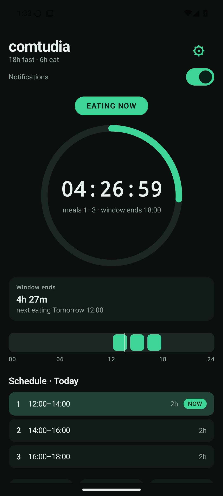
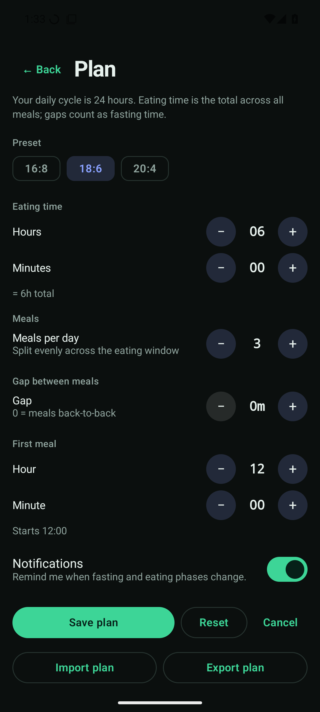

# comtudia for Android

The Android port of comtudia for the Samsung Galaxy S21 FE (Android 14) and any
phone running Android 8.0 or newer. It is the same daily eating plan as the
desktop app, with the same `plan.json` document, so a plan can be moved between
the two.

The phone app is the source of truth for the Wear OS companion: the watch
renders the plan the phone pushes over the Wearable Data Layer. See
[wear.md](wear.md).

## Identity

| Item | Value |
| --- | --- |
| Display name | `comtudia` |
| Application ID | `com.comtudia.app` |
| APK (debug) | `android/app/build/outputs/apk/debug/app-debug.apk` |
| Plan file | `filesDir/comtudia/plan.json` (app-private) |
| Schema | `plan.json` version 1, identical to the desktop file |
| minSdk / targetSdk | 26 / 35 |
| Toolchain | JDK 17, Gradle 8.9, AGP 8.7.3, Kotlin 2.0.21, Compose |

## Features

- Live countdown to the next phase boundary, recomputed from the clock every
  second, never decremented
- Phase-coloured progress ring, 24-hour timeline with meal blocks and a now
  marker, today's meals with the current/next slot highlighted
- Same plan editor as the desktop app: presets 16:8 / 18:6 / 20:4, eating
  hours + minutes with a live total, meal count, meal gap, first-meal time
- Phase-change notifications, plus a silent ongoing card whose countdown
  chronometer keeps ticking without a foreground service
- Exact alarms survive reboots, time changes, timezone changes and app updates
- Import and export the desktop `plan.json` through the system file picker
- No network, no analytics, no account

## Build

The toolchain is self-contained under `~/.local` and needs no sudo:

```bash
tools/android-env.sh        # JDK 17 + Android SDK 35 + Gradle 8.9
source android/env.sh
cd android && ./gradlew :app:assembleDebug
```

Or with `make`:

```bash
make android-env
make android-build          # APK at android/app/build/outputs/apk/debug/
make android-test           # JVM unit tests, including golden vectors
```

The debug APK is signed with the standard Android debug key, which is fine for
sideloading. A release build needs a keystore you control; do not commit it.

## Install on the S21 FE

USB debugging must be enabled (Settings -> About phone -> Software information
-> tap **Build number** seven times, then Developer options -> **USB
debugging**), and the RSA prompt accepted.

```bash
source android/env.sh
adb install -r android/app/build/outputs/apk/debug/app-debug.apk
```

Without a cable, copy `app-debug.apk` to the phone and open it, allowing
"install unknown apps" for the file manager. Samsung may warn about an unknown
developer; the app is not from Play Store.

### First run

1. **Notifications** – allow the permission when prompted. Without it, phase
   alerts do nothing.
2. **Exact alarms** – if the dashboard shows "Exact alarms are off", tap
   **Fix** and allow *Alarms & reminders*. Without it, alerts still fire but
   can be late.
3. **Battery** – Android and One UI may kill a background app. Open
   *Settings -> Apps -> comtudia -> Battery* and choose **Unrestricted**, then
   *Recent apps -> comtudia -> Keep open* if your One UI build offers it.

## Notifications

- The ongoing card stays in the notification shade with a countdown chronometer
  that SystemUI keeps ticking, so no foreground service is needed.
- Phase-change alerts use the desktop wording ("Eating window open",
  "Fasting started", ...) and fire once per contiguous phase.
- Some launchers and OEM skins hide low-importance channels. If the countdown
  card does not appear, raise the `ongoing` channel importance in Android
  settings or rely on the phase alerts.
- Any paired watch that mirrors phone notifications shows the same alerts and
  countdown.

## Moving a plan between desktop and phone

- **Desktop -> phone:** in the Android app, open Settings, tap **Import**, pick
  `plan.json` (for example copied from `~/.config/comtudia/plan.json`).
- **Phone -> desktop:** tap **Export**, save `plan.json`, then copy it to
  `~/.config/comtudia/plan.json` on the Linux machine.
- The schema is identical, and a corrupt or newer-version file is rejected
  rather than overwritten.

## Architecture

```
android/app/src/main/java/com/comtudia/app/
├── MainActivity.kt       one activity: ticker, navigation, permissions, import/export
├── core/                 Plan, Schedule, Format, Notify, PlanJson (pure JVM, no android.*)
├── data/                 PlanRepository (atomic JSON), PhaseStateStore (primed phase key)
├── notify/               channels, ongoing card, phase alerts, message text
├── alarm/                exact-alarm scheduler, phase alarm receiver, reschedule receiver
└── ui/                   Compose dashboard, settings, ring, timeline, meal list, theme
```

`core/` is a direct port of `internal/plan`, `internal/format` and
`internal/notify`, including validation messages, meal splitting, DST
behaviour, and the scan of yesterday/today/tomorrow.

### Parity guard

`internal/plan/golden_test.go` emits `android/core/src/test/resources/schedule-golden.json`
from the Go implementation; `ScheduleGoldenTest` asserts the Kotlin port
produces identical slots, phases and boundaries, including DST days in
Europe/Berlin and America/New_York. Regenerate after an intentional schedule
change:

```bash
go test ./internal/plan/ -run TestGoldenVectors -update
```

### Notification rules

- One alert per contiguous phase. Contiguous meals are a single eating phase,
  so back-to-back meals do not produce extra alerts.
- The last announced phase key is stored in `SharedPreferences` before posting,
  so a killed process or a reboot cannot replay an alert.
- The ongoing card is silent and always reflects the phase; the chronometer is
  rendered from the phase end timestamp by SystemUI.
- Alarms are re-armed after boot, time/timezone changes and app updates.

## Tests

```bash
source android/env.sh
cd android && ./gradlew :app:testDebugUnitTest
```

Covers validation, leftover minutes, gaps, contiguous meals, midnight-crossing
windows, DST, formatting, notifier text, JSON round-tripping, the timeline
helper, and Go/Kotlin golden parity.

## Troubleshooting

| Symptom | Fix |
| --- | --- |
| `adb: no devices/emulators found` | Enable USB debugging, accept the RSA prompt, try another cable. |
| No phase alerts | Grant notifications, set the app to Unrestricted battery, allow exact alarms. |
| Alerts late by minutes | Exact alarms not granted; tap **Fix** on the dashboard banner. |
| Plan will not import | The file must be a version 1 `plan.json`; newer versions and corrupt files are rejected on purpose. |
| Imported plan rejected after editing | A field is out of range, for example a meal spread over 23h. The app validates on save. |

## Screenshots

Captured from a Pixel 6 / Android 15 emulator with the default plan:





Re-capture after UI changes with a temporary plan, never the user's real
timetable.
