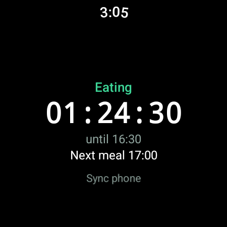

# comtudia on Wear OS

A Wear OS companion for Samsung Galaxy Watch 4/5/6/7 and Watch FE (Wear OS 3+).
It shows the current phase and a drift-free countdown, and **syncs the plan from
the phone**: the watch never edits the plan, so the phone stays the single
source of truth.

Unlike the Xiaomi band, this is a real Android app: `adb install`, no firmware
hacks, no crash risk.



## How sync works

Both APKs use the same application ID, `com.comtudia.app`, which is required for
the Wearable Data Layer.

| Direction | Path | Payload |
| --- | --- | --- |
| Phone → watch | `/comtudia/plan` (data item) | `plan.json` text in the `json` field |
| Watch → phone | `/comtudia/request` (message) | empty |

- The phone pushes the plan on launch, after a save, and after an import
  (`MainActivity.refreshSchedule` → `sync/WearSync.pushPlan`).
- The phone answers a watch request from `sync/WearSyncService`.
- The watch stores the last pushed document in `SharedPreferences`
  (`WearPlanStore`) and recomputes the schedule locally every second.
- On open, the watch sends `/comtudia/request` so a watch that was offline
  catches up immediately.

The watch keeps working offline: it renders the last synced plan with the
watch's own clock.

## Build

```bash
source android/env.sh
cd android && ./gradlew :wear:assembleDebug
```

Output: `android/wear/build/outputs/apk/debug/wear-debug.apk` (about 24 MB in
debug; most of it is Compose and Play Services).

The phone APK also references the watch module through `wearApp`, so
`make android-build` keeps both in one build.

## Install

### Wireless debugging (recommended)

1. Watch: **Settings → About watch → Software information**, tap **Build
   number** seven times.
2. Watch: **Settings → Developer options → Wireless debugging** → on.
3. Watch: **Pair new device** — note the IP:port and the six-digit code.
4. Phone and watch on the same Wi-Fi as the computer, then:

```bash
adb pair <watch-ip>:<pair-port> <code>
adb connect <watch-ip>:<debug-port>
adb devices                       # the watch appears as <watch-ip>:<debug-port>
adb -s <watch-ip>:<debug-port> install -r android/wear/build/outputs/apk/debug/wear-debug.apk
```

The wireless port changes when debugging is toggled; re-check the watch screen.
The computer and the watch must be on the same subnet: if `adb connect` reports
"No route to host", they are on different networks (this happened during the
reference install, where the laptop was wired to `192.168.0.x` and the watch was
on `192.168.1.x`). Move the watch to the computer's network, or the computer to
the watch's, then retry.

### Debug over Bluetooth (through the phone)

This works on watches that expose the Wear OS ADB hub, but **not on Samsung
watches managed by Galaxy Wearable**: the hub is served by the Wear OS phone app
(`com.google.android.wearable.app`), which is not installed when Galaxy Wearable
is the companion. On the S21 FE, `adb forward tcp:4444 localabstract:/adb-hub`
succeeds but the watch never answers (`offline`). Use Wireless debugging
instead.

If your phone does have the Wear OS app:

1. Watch: **Developer options → Debug over Bluetooth** → on.
2. The phone is already connected over USB:

```bash
adb -s <phone-serial> forward tcp:4444 localabstract:/adb-hub
adb connect 127.0.0.1:4444
adb -s 127.0.0.1:4444 install -r android/wear/build/outputs/apk/debug/wear-debug.apk
```

## First run

1. Install the phone app **before** the watch app; the watch needs the phone
   service to answer its request.
2. Install and open comtudia on the watch. It sends `/comtudia/request`; the
   phone pushes the plan; the dashboard appears within a second or two.
3. If the watch shows the default 18:6 plan instead of your plan, the sync has
   not completed — open the phone app once (it pushes on launch), then tap
   **Sync phone** on the watch.

## Verified on hardware

2026-10-27, Samsung Galaxy Watch5 (`SM-R910`, Wear OS 6 / Android 16, API 36),
paired to the S21 FE:

- `adb pair` and `adb connect` over Wireless debugging succeeded; mDNS
  advertised both `_adb-tls-pairing` and `_adb-tls-connect`.
- `adb install -r wear-debug.apk` returned `Success`; the watch reports
  `com.comtudia.app` version 0.1.0.
- Opening the app pulled the phone's plan through the Data Layer into
  `shared_prefs/comtudia_watch.xml`: 18:6, 3 meals, 30-minute gaps, start
  12:00 (the phone's real plan, not the default).
- The dashboard showed `Eating · 01:24:30 · until 16:30 · Next meal 17:00` at
  15:05, matching meals 14:30-16:30 and 17:00-19:00.

## Verification

```bash
adb -s <watch> shell dumpsys package com.comtudia.app | grep versionName
adb -s <watch> shell run-as com.comtudia.app cat shared_prefs/comtudia_watch.xml
adb -s <watch> logcat -s WearSync WearableDataLayerService
```

On the phone, `adb logcat -s WearSync` shows push failures (for example when
Play Services is missing or the watch is not paired).

## Limits

- No tile or watch-face complication yet; the app is a normal Wear OS entry in
  the app list. Both are straightforward follow-ups using
  `androidx.wear.tiles` and `androidx.wear.watchface.complications`.
- The watch app has no plan editor by design. Edit on the phone.
- Debug APKs are larger than release builds; a release build needs your own
  keystore.
- The Data Layer requires Google Play Services on the phone and the watch,
  which Samsung Wear OS watches have.

## Troubleshooting

| Symptom | Fix |
| --- | --- |
| `adb pair` fails | Use the pairing port, not the debug port, and re-open the pairing dialog for a fresh code. |
| Watch not listed | Toggle Wireless debugging off/on; confirm both devices are on the same network. |
| Watch shows the default plan | Open the phone app once, then tap **Sync phone** on the watch. |
| Sync still fails | Check `adb logcat -s WearSync` on both devices; confirm Galaxy Wearable still shows the watch as paired. |
| `INSTALL_FAILED_UPDATE_INCOMPATIBLE` | Uninstall the old package on the watch: `adb -s <watch> uninstall com.comtudia.app`. |
